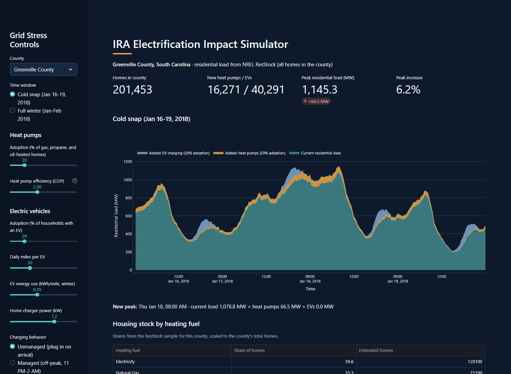

# IRA Grid Stress Simulator

[](https://github.com/livingdw67/grid-stress-simulator/actions/workflows/tests.yml)

**How much do Inflation Reduction Act incentives for heat pumps and electric vehicles raise winter peak load on South Carolina's grid?**

**[Try it live →](https://grid-stress-simulator.streamlit.app)** Pick a county, set heat pump and EV adoption, and see the new winter peak. No setup needed.

[](https://grid-stress-simulator.streamlit.app)

## Why It Matters

The Inflation Reduction Act gives households tax credits and rebates for two big electrification moves: replacing gas, propane, and oil furnaces with electric heat pumps, and buying electric vehicles. Both cut emissions, and both shift energy use onto the electric grid.

Timing is the problem. Heat pumps work hardest on the coldest mornings, and unmanaged EV charging lands in the early evening when people get home. If adoption clusters in one area, local transformers and feeders can be pushed past their limits.

This tool lets a utility planner pick a county, set adoption rates for heat pumps and EVs, and see how the winter peak changes before the installs happen.

## Approach

1. **Current load (all homes):** NREL [ResStock](https://resstock.nrel.gov/) county aggregates give 15-minute electricity use for every home in each South Carolina county (single-family, multi-family, and mobile homes), from the AMY2018 release on NREL's public S3 data lake.
2. **Heat pumps:** For the chosen share of gas, propane, and oil-heated homes, fuel used for heating is converted to delivered heat (80% furnace efficiency), then to heat pump electricity using the selected efficiency (COP).
3. **EV charging:** Each EV needs `daily miles × kWh/mile` per day. Unmanaged charging starts when drivers get home (centered on 6 PM); managed charging is staggered across an 11 PM–2 AM off-peak window. The expected charging curve is applied to the chosen share of households.
4. **Peak impact:** The three loads are stacked over the January 16–19, 2018 cold snap (or all of January–February) to show the new peak and what drives it.

All loads are shown as average power in MW. ResStock reports energy per 15-minute interval, so kW = kWh × 4.

## Example Findings: Greenville County, January 2018 Cold Snap

With 20% heat pump adoption (COP 2.5) and 20% of households owning an EV (30 miles/day):

* **Baseline peak:** about 1,079 MW across roughly 201,000 homes, at 8 AM on January 18. About 74% of South Carolina homes already heat with electricity, so the winter morning peak is heating-driven.
* **Heat pumps** add about 67 MW at that peak, a 6.2% increase.
* **Unmanaged EV charging** adds almost nothing to the morning peak because it lands around 6 PM.
* **Off-peak timers backfire:** when every EV starts charging at 11 PM, a new midnight peak forms on cold nights, about 1,150 MW with 97 MW of EV load, higher than the original morning peak. Staggered or utility-managed charging matters more than a simple time-of-use window.

## Dashboard

* **Controls:** county (or all 46 counties at once), time window, heat pump adoption and efficiency, EV adoption, daily miles, winter kWh/mile, charger power, and managed vs. unmanaged charging
* **Headline metrics:** homes in the county or state, new heat pumps and EVs, new peak load, and percent increase in peak
* **Stacked load chart:** current load plus added heat pump and EV load
* **Peak breakdown:** when the new peak occurs and how much each source contributes
* **Housing stock by heating fuel** for the selected county or the whole state

### Slider guide bands

Two lines on each slider mark a reasonable range for about 2035, roughly the end of the IRA incentive window. They guide the user without limiting them: the full slider is still available for extreme scenarios. Each band comes from published figures plus simple stock-turnover arithmetic:

| Slider | Band | How it's calculated |
|---|---|---|
| Heat pump adoption | 5-25% | Furnaces last 15-20 years, so 50-67% are replaced by 2035. If 10-40% of those replacements switch to a heat pump (an assumption, since no survey tracks the switching rate), 5-27% of gas, propane, and oil-heated homes convert. |
| Heat pump COP | 1.8-3.0 | Low: ENERGY STAR cold-climate heat pumps must reach a COP of 1.75 at 5°F ([spec v6.2](https://www.energystar.gov/sites/default/files/2026-02/HP%20Version%206.2%20Specification%20Revised%20February%202026.pdf)). High: a high-efficiency unit's seasonal COP (HSPF2 10 ÷ 3.412 ≈ 2.9). Cold-snap mornings sit near the low end. |
| EV adoption | 5-20% | About 32,000 of South Carolina's 3.5 million registered vehicles are EVs ([SC Daily Gazette, Sept 2025](https://scdailygazette.com/2025/09/18/sc-electric-vehicle-sales-have-risen-slightly-but-tax-credits-for-buyers-are-about-to-expire/)), about 1%. Roughly 55% of vehicles are replaced by 2035; if EVs take 4% (today's SC share) to 20% of those sales, EVs are 3-12% of vehicles, or 5-19% of households at 1.6 vehicles per household. |
| Daily miles per EV | 25-40 | The average light-duty vehicle is driven 11,106 miles a year, about 30 a day ([FHWA Highway Statistics 2023, VM-1](https://www.fhwa.dot.gov/policyinformation/statistics/2023/vm1.cfm)). Second cars drive less; rural commutes drive more. |
| EV energy use | 0.32-0.47 kWh/mile | Popular EVs are rated about 0.28-0.33 kWh/mile ([fueleconomy.gov](https://www.fueleconomy.gov/feg/bymake/Tesla2025.shtml)). Between 32°F and 20°F they keep 70-88% of their range ([Recurrent, Nov 2025](https://www.recurrentauto.com/research/winter-ev-range-loss)), so they need 14-43% more energy per mile: 0.28 ÷ 0.88 to 0.33 ÷ 0.70. |

Charger power has no band because its four settings are all common home chargers. The bands live in `GUIDE_BANDS` in `grid_model.py`.

## Run It

```bash
git clone https://github.com/livingdw67/grid-stress-simulator.git
cd grid-stress-simulator
pip install -r requirements.txt

python build_county_profiles.py   # 1. Build county winter load profiles from NREL (optional: file is included)
python pull_resstock_data.py      # 2. Pull SC housing characteristics (optional: CSV is included)
streamlit run app.py              # 3. Launch the dashboard
```

The processed data files are committed, so you can go straight to step 3.

## Tests

```bash
pip install pytest
pytest
```

28 tests run on every push through GitHub Actions:
* **Model checks** on synthetic data: each EV charging curve delivers exactly the daily energy and never exceeds the charger's power, managed charging stays overnight, heat pump load scales correctly with adoption and COP, and the statewide load equals the sum of the county loads.
* **Findings checks** on the committed data: every Greenville County number in the section above is recomputed and must match.
* **Dashboard checks:** the Streamlit app runs headlessly with both charging modes and the statewide view, and every guide band sits inside its slider and around the slider's default.

The load model lives in `grid_model.py`, separate from the dashboard in `app.py`.

`analyze_single_home.py` is a standalone deep dive showing how one gas-heated home's load changes after switching to a heat pump (`grid_stress_test_chart.png`).

## Limitations and Next Steps

* **County as a proxy for a feeder.** True transformer-level analysis needs a utility's feeder and GIS data, and adoption tends to cluster on specific streets.
* **Fixed heat pump efficiency.** Real COP drops as temperatures fall. Next: temperature-dependent COP from the weather data behind ResStock.
* **Simplified EV behavior.** One EV per adopting household and a single arrival-time distribution. Next: NREL EVI-Pro charging profiles and workplace charging.
* **2018 weather and housing stock.** Results reflect the AMY2018 ResStock release, before recent heat pump and EV growth.

## Tech Stack

Python, pandas, NumPy, PyArrow, s3fs (NREL public S3), Streamlit, Plotly, Matplotlib, Seaborn, pytest, GitHub Actions
